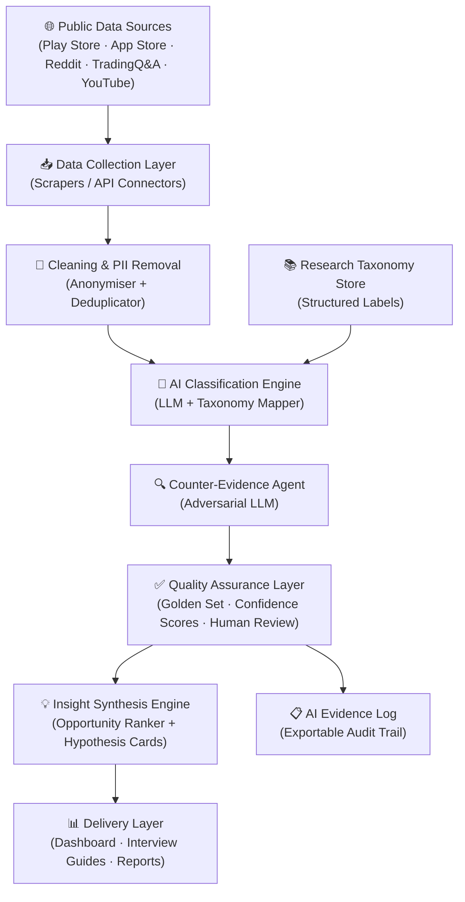
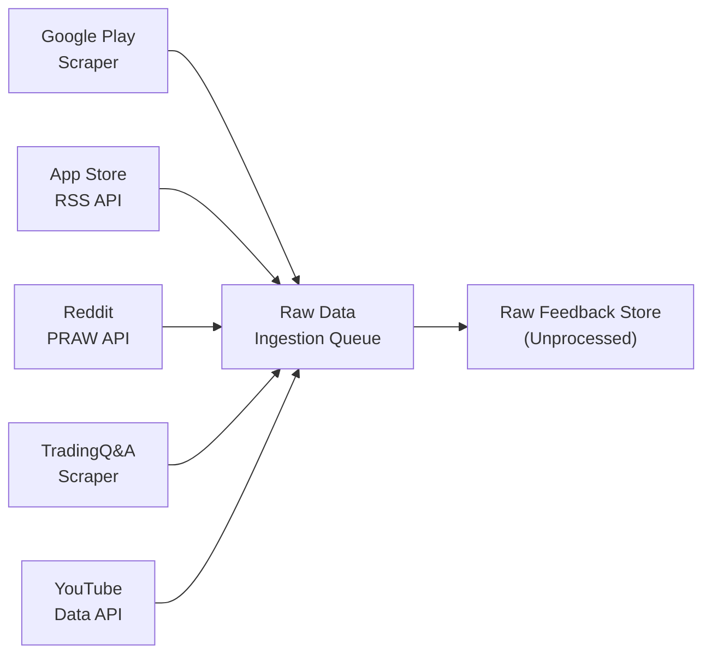
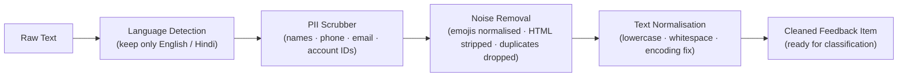
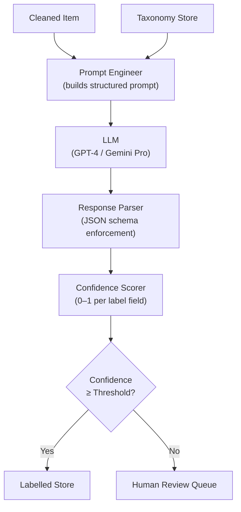
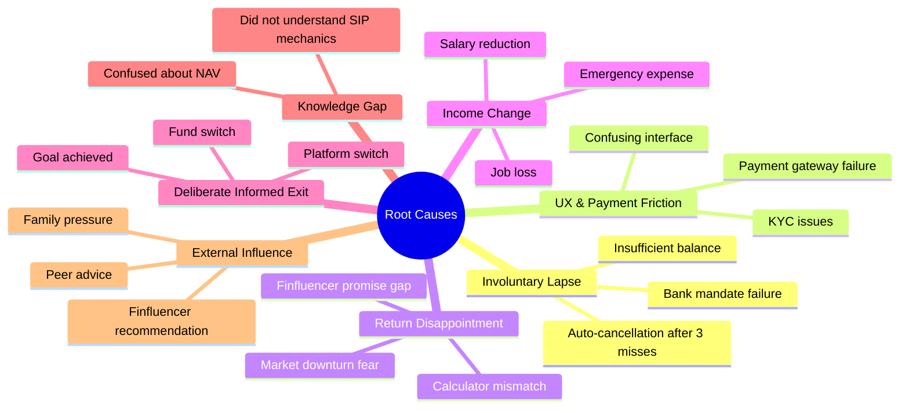
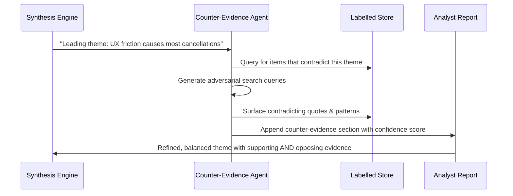
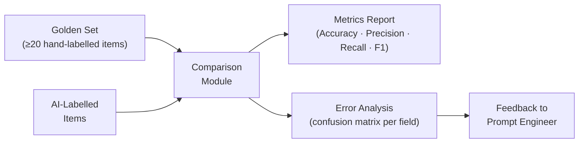
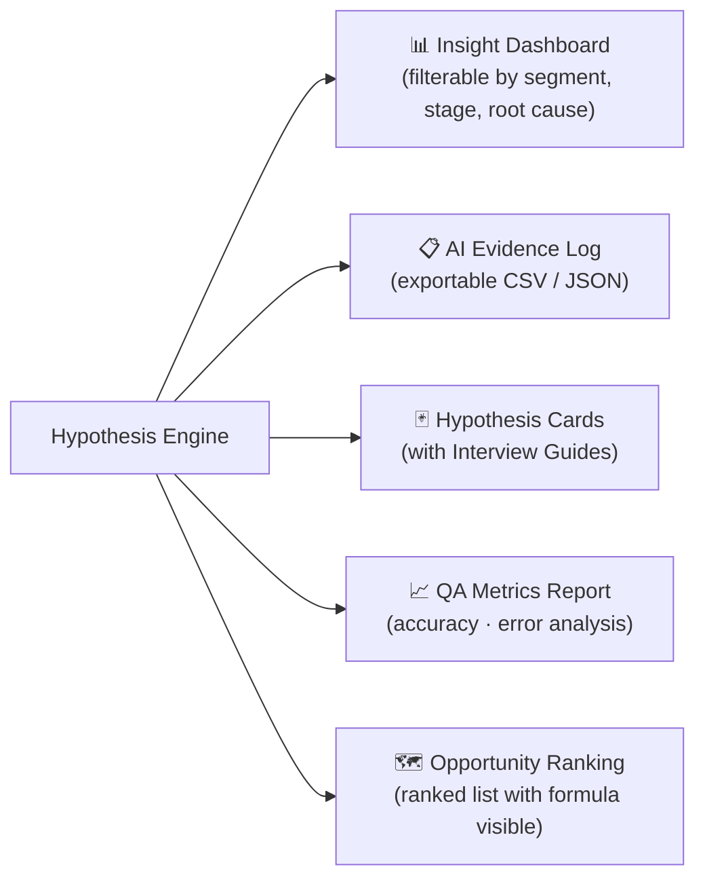
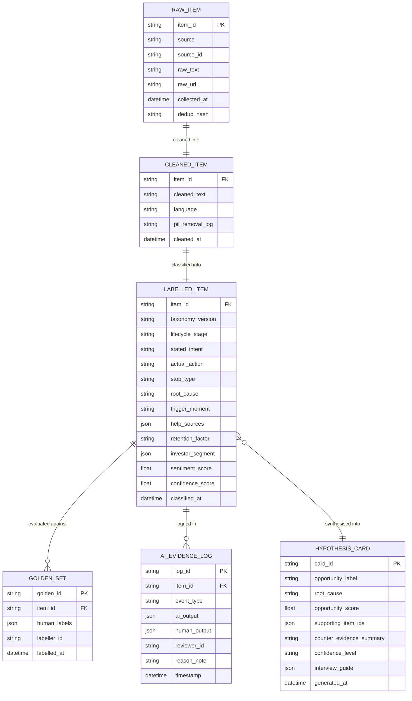
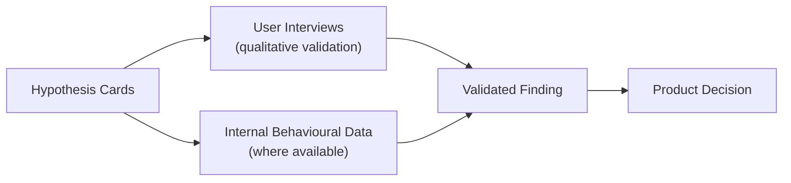

# SIP Insight Lab — System Architecture

> **Project:** AI-Powered Discovery Engine for SIP Retention  
> **Team:** Growth — Groww  
> **Goal:** Understand *why* first-time MF investors churn within 12 months and *which* churns a better product could prevent.

---

## Table of Contents

1. [High-Level Architecture Overview](#1-high-level-architecture-overview)
2. [Layer 1 — Data Collection](#2-layer-1--data-collection)
3. [Layer 2 — Data Cleaning & PII Removal](#3-layer-2--data-cleaning--pii-removal)
4. [Layer 3 — Classification Engine](#4-layer-3--classification-engine)
5. [Layer 4 — Research Taxonomy](#5-layer-4--research-taxonomy)
6. [Layer 5 — Counter-Evidence Agent](#6-layer-5--counter-evidence-agent)
7. [Layer 6 — Quality Assurance](#7-layer-6--quality-assurance)
8. [Layer 7 — Insight Synthesis & Hypothesis Engine](#8-layer-7--insight-synthesis--hypothesis-engine)
9. [Layer 8 — Output & Delivery](#9-layer-8--output--delivery)
10. [Data Model](#10-data-model)
11. [Key Design Decisions](#11-key-design-decisions)
12. [Ethics & Constraints](#12-ethics--constraints)

---

## 1. High-Level Architecture Overview



---

## 2. Layer 1 — Data Collection

### Purpose
Gather permitted, publicly available investor feedback from five sources at scale.

### Sources & Connectors

| Source | Method | Data Captured |
|---|---|---|
| **Google Play Store** | Play Store RSS / Scraper | Star rating, review text, app version, date |
| **Apple App Store** | iTunes RSS API | Star rating, review text, country, date |
| **Reddit** | Reddit Public API (PRAW) | Post text, comment threads, subreddit, score, date |
| **TradingQ&A** | HTTP Scraper (Permitted) | Q&A text, tags, vote count, date |
| **YouTube** | YouTube Data API v3 | Comment text, video ID, like count, date |

### Collection Rules
- Only **permitted public data** is collected (no private messages, no authenticated sessions)
- Each item is stamped with: `source`, `source_id`, `collected_at`, `raw_url`
- Rate limits and platform ToS are strictly observed
- A **deduplication hash** (SHA-256 of normalised text) is computed at ingestion



---

## 3. Layer 2 — Data Cleaning & PII Removal

### Purpose
Standardise raw text and remove any personal identifiers before analysis.

### Pipeline Steps



### PII Removal Rules
- Named Entity Recognition (NER) model tags `PERSON`, `EMAIL`, `PHONE`, `ORG`
- All tagged spans replaced with `[REDACTED]`
- Account numbers / UPI IDs matched via regex and masked
- Output is logged (what was removed, not the value) for audit

---

## 4. Layer 3 — Classification Engine

### Purpose
Apply structured labels from the Research Taxonomy to each cleaned feedback item using an LLM.

### Architecture



### Classification Output Fields (per item)

| Field | Type | Description |
|---|---|---|
| `lifecycle_stage` | enum | `pre_first_sip` · `0–3mo` · `3–6mo` · `6–12mo` · `12mo+` |
| `stated_intent` | enum | `continue` · `pause` · `stop` · `neutral` · `unknown` |
| `actual_action` | enum | `active` · `paused` · `cancelled` · `unknown` |
| `stop_type` | enum | `involuntary_lapse` · `deliberate_exit` · `not_applicable` |
| `root_cause` | enum | see Taxonomy (§5) |
| `trigger_moment` | string | Textual description of the triggering event |
| `help_source` | list | Where user sought help outside the app |
| `retention_factor` | string | For continuers — what kept them going |
| `investor_segment` | object | `age_group`, `income_stability`, `money_source`, `influencer_type` |
| `sentiment_score` | float | –1.0 to +1.0 |
| `confidence_score` | float | 0.0 to 1.0 (overall classification confidence) |

> **Critical Separation:** `stated_intent` and `actual_action` are always stored as **separate fields** to avoid conflating what investors say with what they do.

---

## 5. Layer 4 — Research Taxonomy

### Purpose
Provide a consistent, versioned label vocabulary used by the Classification Engine.

### Root Cause Categories



### Retention Factor Categories

| Code | Label |
|---|---|
| `RF-01` | Seeing positive returns (even small) |
| `RF-02` | Community / peer encouragement |
| `RF-03` | App nudges or reminders |
| `RF-04` | Long-term goal tracking visible |
| `RF-05` | Educational content within app |
| `RF-06` | Automated / hassle-free experience |

### Taxonomy Versioning
- Taxonomy is stored as a **versioned YAML file** (`taxonomy_v1.yaml`, `taxonomy_v2.yaml`, …)
- Every classified item stores the `taxonomy_version` it was labelled with
- Schema changes trigger a **re-classification run** on affected items

---

## 6. Layer 5 — Counter-Evidence Agent

### Purpose
Prevent confirmation bias by actively searching for evidence that contradicts each emerging theme.

### How It Works



### Counter-Evidence Strategies
1. **Inverse Query:** Search for items where UX was praised by churned users
2. **Segment Drill-down:** Check if the theme holds across all investor segments or only specific ones
3. **Temporal Check:** Does the pattern hold across all months, or only certain periods?
4. **Frequency Sanity:** Is the theme being driven by a small vocal minority?

---

## 7. Layer 6 — Quality Assurance

### Purpose
Ensure classification reliability is measured, reported, and continuously improved.

### Golden Set Evaluation



### QA Metrics Tracked

| Metric | Description | Target |
|---|---|---|
| **Overall Accuracy** | % exact-match across all fields | ≥ 80% |
| **Per-field F1** | F1 score for each taxonomy label | ≥ 0.75 per field |
| **Low-confidence Rate** | % of items routed to human review | < 20% |
| **Human Override Rate** | % of AI decisions corrected by humans | Reported openly |

### AI Evidence Log Schema

Every human correction or AI output rejection is written to an **exportable AI Evidence Log**:

```json
{
  "log_id": "uuid",
  "item_id": "feedback item reference",
  "timestamp": "ISO-8601",
  "event_type": "correction | rejection | approval",
  "ai_output": { "field": "value", "confidence": 0.0 },
  "human_output": { "field": "corrected_value" },
  "reviewer_id": "anonymised",
  "reason_note": "optional free text"
}
```

---

## 8. Layer 7 — Insight Synthesis & Hypothesis Engine

### Purpose
Transform classified data into ranked opportunities and actionable hypothesis cards.

### Opportunity Ranking Formula

```
Opportunity Score =
  (Frequency_Score × 0.30)
  + (Severity_Score × 0.25)
  + (First_6mo_Concentration × 0.25)
  + (Addressability_Score × 0.20)
```

| Component | Definition |
|---|---|
| **Frequency Score** | Normalised count of items in this root cause bucket |
| **Severity Score** | Weighted average sentiment magnitude for the bucket |
| **First_6mo_Concentration** | % of bucket items occurring within the first 6 months of SIP |
| **Addressability Score** | 1 if solvable without investment advice or fear nudges; 0 otherwise |

### Hypothesis Card Structure

```markdown
## Hypothesis Card — [ID]

**Opportunity:** [One-sentence description]
**Root Cause:** [Taxonomy label]
**Frequency:** [N items / % of total corpus]
**Lifecycle Stage Most Affected:** [e.g., 3–6 months]
**Supporting Quotes:** [3–5 verbatim, anonymised quotes]
**Counter-Evidence:** [Summary from Counter-Evidence Agent]
**Confidence:** [High / Medium / Low]
**Opportunity Score:** [Calculated value]

### Interview Guide
1. [Question to validate this hypothesis with a real investor]
2. ...
```

---

## 9. Layer 8 — Output & Delivery

### Outputs Produced



### Dashboard Filters

| Dimension | Filter Options |
|---|---|
| **Lifecycle Stage** | pre-SIP · 0–3mo · 3–6mo · 6–12mo · 12mo+ |
| **Root Cause** | Full taxonomy tree |
| **Stop Type** | Involuntary · Deliberate · Unknown |
| **Investor Segment** | Age group · Income stability · Money source · Influencer type |
| **Source** | Play Store · App Store · Reddit · TradingQ&A · YouTube |
| **Intent vs. Action** | Gap view (stated ≠ actual) |
| **Time Period** | Date range of feedback collected |

---

## 10. Data Model



---

## 11. Key Design Decisions

| Decision | Rationale |
|---|---|
| **Intent and Action stored as separate fields** | Prevents conflating what investors say with what they do — the core trap identified in the problem statement |
| **Taxonomy is versioned** | Enables re-classification when the label schema evolves without losing historical data |
| **Counter-Evidence Agent is a separate LLM call** | Structurally prevents the primary classifier from anchoring to its own output |
| **Confidence threshold routing** | Low-confidence items go to humans rather than being silently mislabelled |
| **Opportunity Score formula is visible** | Builds trust with stakeholders — no black-box prioritisation |
| **Public feedback = hypotheses only** | Findings are explicitly validated via interviews and behavioural data, not treated as ground truth |
| **No fund / stock recommendations** | Ethical boundary — the engine informs product decisions, not investment advice |

---

## 12. Ethics & Constraints

> **Foundational Principle:** Public feedback is a source of *hypotheses*, not a measure of retention or proof of causality.

### Hard Constraints

| Constraint | Enforcement |
|---|---|
| No specific fund / stock recommendations | Blocked at prompt level + output validation |
| No fear, FOMO, urgency, or manipulative nudge generation | Hypothesis cards reviewed against a nudge checklist |
| No PII in any downstream output | PII scrubber runs before classification; output layer strips residual identifiers |
| All AI corrections / rejections logged | AI Evidence Log is append-only and exportable |
| Findings validated before product decisions | Hypothesis cards include interview guide; internal data cited where available |

### Validation Pipeline



---

*Architecture document based on: [`ProblemStatement.txt`](file:///c:/Users/nagas/Downloads/Grad%20project-grow/ProblemStatement.txt)*  
*Generated: 2026-10-26*
