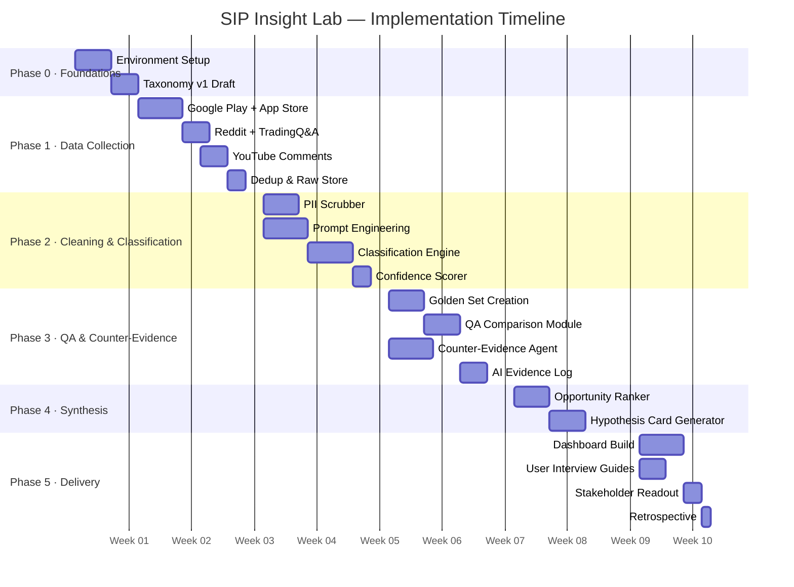
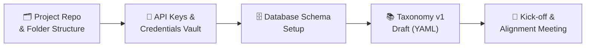
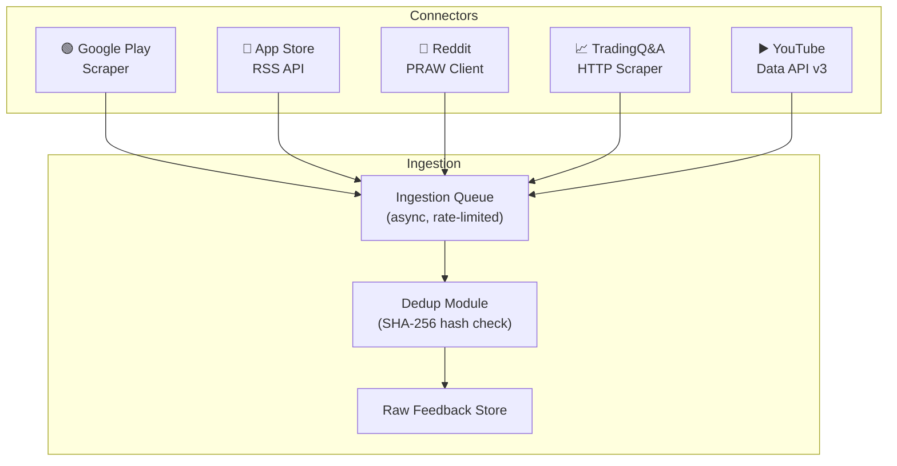
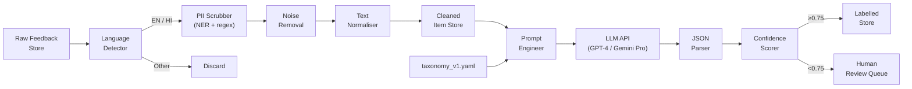
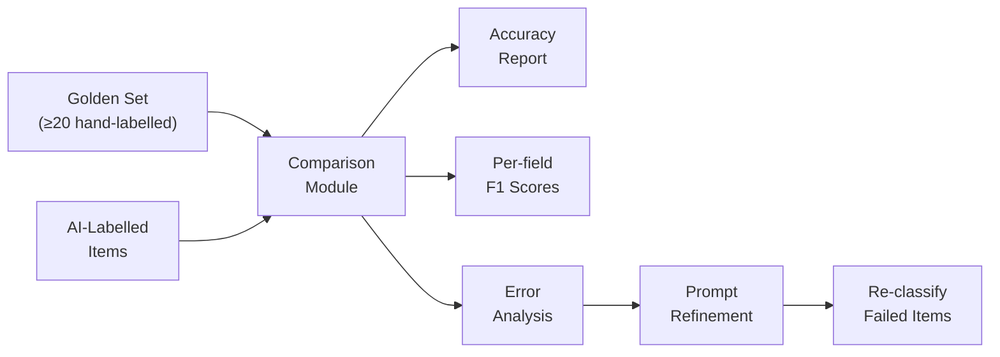
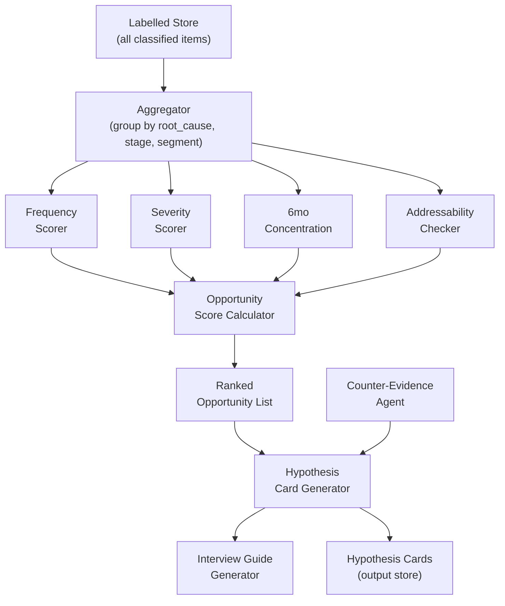
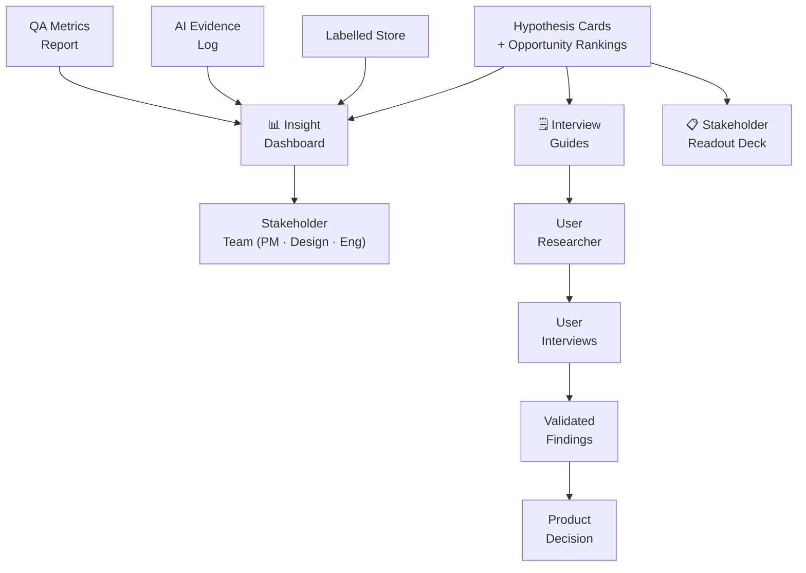
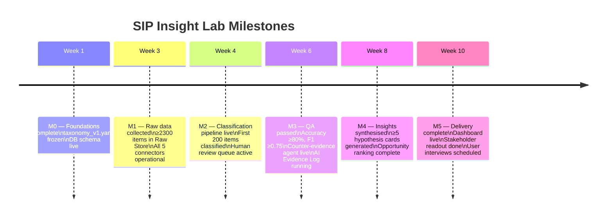

# SIP Insight Lab — Phase-Wise Implementation Plan

> **Project:** AI-Powered Discovery Engine for SIP Retention  
> **Team:** Growth — Groww  
> **Total Duration:** 10 Weeks (across 5 phases)

---

## Table of Contents

1. [Implementation Overview](#1-implementation-overview)
2. [Phase 0 — Foundations & Setup](#2-phase-0--foundations--setup-week-1)
3. [Phase 1 — Data Collection Pipeline](#3-phase-1--data-collection-pipeline-weeks-23)
4. [Phase 2 — Taxonomy, Cleaning & Classification Engine](#4-phase-2--taxonomy-cleaning--classification-engine-weeks-34)
5. [Phase 3 — Quality Assurance & Counter-Evidence Agent](#5-phase-3--quality-assurance--counter-evidence-agent-weeks-56)
6. [Phase 4 — Insight Synthesis & Hypothesis Engine](#6-phase-4--insight-synthesis--hypothesis-engine-weeks-78)
7. [Phase 5 — Delivery, Validation & Handoff](#7-phase-5--delivery-validation--handoff-weeks-910)
8. [Milestone Summary](#8-milestone-summary)
9. [Risk Register](#9-risk-register)
10. [Definition of Done](#10-definition-of-done)

---

## 1. Implementation Overview

### Phased Roadmap



### Architecture Layer → Phase Mapping

| Architecture Layer | Implementation Phase |
|---|---|
| Research Taxonomy Store | Phase 0 |
| Data Collection (Layer 1) | Phase 1 |
| Cleaning & PII Removal (Layer 2) | Phase 2 |
| Classification Engine (Layer 3) | Phase 2 |
| Counter-Evidence Agent (Layer 5) | Phase 3 |
| Quality Assurance (Layer 6) | Phase 3 |
| Insight Synthesis & Hypothesis Engine (Layer 7) | Phase 4 |
| Output & Delivery (Layer 8) | Phase 5 |

---

## 2. Phase 0 — Foundations & Setup (Week 1)

> **Goal:** Establish infrastructure, define the research taxonomy, and align the team before any code is written.

### Tasks



### Detailed Task List

| # | Task | Owner | Output | Duration |
|---|---|---|---|---|
| 0.1 | Create project repository with folder structure (`/data`, `/src`, `/taxonomy`, `/golden_set`, `/outputs`) | Engineer | Repo scaffolding | 0.5d |
| 0.2 | Provision secure credentials vault for API keys (Reddit, YouTube, Play Store) | Engineer | `.env` template + vault config | 0.5d |
| 0.3 | Set up database schema (`RAW_ITEM`, `CLEANED_ITEM`, `LABELLED_ITEM`, `GOLDEN_SET`, `AI_EVIDENCE_LOG`, `HYPOTHESIS_CARD`) | Engineer | DB schema file | 1d |
| 0.4 | Draft `taxonomy_v1.yaml` with root cause categories, retention factors, lifecycle stages, stop types, investor segments | PM + Researcher | `taxonomy_v1.yaml` | 1.5d |
| 0.5 | Review taxonomy with stakeholders and freeze v1 | PM | Approved taxonomy | 0.5d |
| 0.6 | Define confidence threshold (default: 0.75) and human review SLA | PM + Engineer | Config file | 0.5d |
| 0.7 | Kick-off meeting — share architecture, plan, and ethics constraints with all contributors | PM | Meeting notes | 0.5d |

### Taxonomy v1 YAML Structure

```yaml
# taxonomy_v1.yaml
version: "1.0"
lifecycle_stages:
  - pre_first_sip
  - 0_3mo
  - 3_6mo
  - 6_12mo
  - 12mo_plus

stop_types:
  - involuntary_lapse
  - deliberate_exit
  - not_applicable

root_causes:
  - code: RC-01
    label: Involuntary Lapse
    subcategories:
      - Insufficient balance
      - Bank mandate failure
      - Auto-cancellation after 3 misses
  - code: RC-02
    label: UX & Payment Friction
    subcategories:
      - Confusing interface
      - Payment gateway failure
      - KYC issues
  - code: RC-03
    label: Return Disappointment
    subcategories:
      - Calculator mismatch
      - Finfluencer promise gap
      - Market downturn fear
  - code: RC-04
    label: Income Change
    subcategories:
      - Job loss
      - Salary reduction
      - Emergency expense
  - code: RC-05
    label: Deliberate Informed Exit
    subcategories:
      - Goal achieved
      - Fund switch
      - Platform switch
  - code: RC-06
    label: Knowledge Gap
    subcategories:
      - Did not understand SIP mechanics
      - Confused about NAV
  - code: RC-07
    label: External Influence
    subcategories:
      - Peer advice
      - Finfluencer recommendation
      - Family pressure

retention_factors:
  - code: RF-01
    label: Seeing positive returns (even small)
  - code: RF-02
    label: Community / peer encouragement
  - code: RF-03
    label: App nudges or reminders
  - code: RF-04
    label: Long-term goal tracking visible
  - code: RF-05
    label: Educational content within app
  - code: RF-06
    label: Automated / hassle-free experience
```

### Phase 0 Exit Criteria

- [ ] Repository created and accessible to all contributors
- [ ] API credentials provisioned (Reddit, YouTube, Play Store)
- [ ] Database schema reviewed and approved
- [ ] `taxonomy_v1.yaml` frozen and version-controlled
- [ ] Kick-off meeting completed; ethics constraints acknowledged by all

---

## 3. Phase 1 — Data Collection Pipeline (Weeks 2–3)

> **Goal:** Build and validate five source connectors; populate the Raw Feedback Store with a first batch of ≥500 items per source.

### Pipeline Overview



### Detailed Task List

| # | Task | Owner | Output | Duration |
|---|---|---|---|---|
| 1.1 | Build Google Play Store scraper (star rating, review text, app version, date) | Engineer | `scrapers/play_store.py` | 1.5d |
| 1.2 | Build App Store RSS API connector (iTunes API, EN + IN locales) | Engineer | `scrapers/app_store.py` | 1d |
| 1.3 | Build Reddit PRAW client (target: r/IndiaInvestments, r/mutualfunds, r/Groww) | Engineer | `scrapers/reddit.py` | 1d |
| 1.4 | Build TradingQ&A HTTP scraper (permitted, rate-limited) | Engineer | `scrapers/tradingqa.py` | 1.5d |
| 1.5 | Build YouTube Data API v3 connector (comments on Groww-related / MF-related videos) | Engineer | `scrapers/youtube.py` | 1d |
| 1.6 | Build async ingestion queue with rate-limiter and retry logic | Engineer | `ingestion/queue.py` | 1d |
| 1.7 | Implement SHA-256 deduplication module | Engineer | `ingestion/dedup.py` | 0.5d |
| 1.8 | Write raw items to DB (`RAW_ITEM` table) with required metadata stamps | Engineer | DB populated | 0.5d |
| 1.9 | Run first collection batch; validate ≥500 items per source | PM + Engineer | Collection QA report | 1d |
| 1.10 | Verify ToS compliance for each source; document in `data/SOURCES.md` | PM | `data/SOURCES.md` | 0.5d |

### Collection Targets (First Batch)

| Source | Min Items | Search Terms / Scope |
|---|---|---|
| Google Play | 500 | Groww app reviews (all ratings) |
| App Store | 500 | Groww app reviews (all ratings, IN store) |
| Reddit | 500 | r/IndiaInvestments, r/mutualfunds, r/Groww — SIP-related posts & comments |
| TradingQ&A | 300 | Questions tagged `sip`, `mutual-fund`, `groww` |
| YouTube | 500 | Comments on top 20 Groww / personal finance SIP videos |

### Phase 1 Exit Criteria

- [ ] All 5 connectors operational and passing unit tests
- [ ] ≥2,300 raw items in `RAW_ITEM` table across all sources
- [ ] Deduplication rate reported (< 30% expected on first pass)
- [ ] ToS compliance document signed off by PM
- [ ] No PII in raw item `source_id` or `raw_url` fields

---

## 4. Phase 2 — Taxonomy, Cleaning & Classification Engine (Weeks 3–4)

> **Goal:** Clean all raw items through the PII pipeline, then build and test the LLM-based classification engine against the taxonomy.

### Pipeline Overview



### Detailed Task List

**Cleaning Sub-pipeline**

| # | Task | Owner | Output | Duration |
|---|---|---|---|---|
| 2.1 | Integrate language detection library (`langdetect` / `fasttext`); filter for EN and HI | Engineer | `cleaning/lang_detect.py` | 0.5d |
| 2.2 | Implement NER-based PII tagger (spaCy `en_core_web_trf`); tag PERSON, EMAIL, PHONE, ORG | Engineer | `cleaning/pii_scrubber.py` | 1.5d |
| 2.3 | Add regex rules for UPI IDs, account numbers, Aadhar patterns | Engineer | Added to pii_scrubber | 0.5d |
| 2.4 | Build noise removal module (HTML strip, emoji normalise, duplicate sentence removal) | Engineer | `cleaning/noise_removal.py` | 0.5d |
| 2.5 | Build text normaliser (lowercase, whitespace, encoding fix) | Engineer | `cleaning/normaliser.py` | 0.5d |
| 2.6 | Write cleaned items to `CLEANED_ITEM` table; log PII removal summary (counts, not values) | Engineer | DB populated | 0.5d |
| 2.7 | Manual spot-check of 50 cleaned items for PII leakage | PM + Researcher | Spot-check report | 0.5d |

**Classification Engine Sub-pipeline**

| # | Task | Owner | Output | Duration |
|---|---|---|---|---|
| 2.8 | Write base prompt template with taxonomy injected as structured context | PM + Engineer | `prompts/classify_v1.txt` | 1.5d |
| 2.9 | Build prompt engineer module (injects taxonomy, item text, few-shot examples) | Engineer | `classification/prompt_builder.py` | 1d |
| 2.10 | Build LLM API wrapper with retry/backoff and token usage logging | Engineer | `classification/llm_client.py` | 1d |
| 2.11 | Build JSON response parser with schema enforcement (Pydantic model) | Engineer | `classification/parser.py` | 1d |
| 2.12 | Build confidence scorer (per-field and aggregate; configurable threshold) | Engineer | `classification/confidence.py` | 0.5d |
| 2.13 | Implement human review queue router (items below threshold → `HUMAN_REVIEW` flag) | Engineer | `classification/router.py` | 0.5d |
| 2.14 | Run classification on first 200 items; review outputs with PM | PM + Engineer | Pilot classification report | 1d |
| 2.15 | Iterate on prompt based on pilot review; re-run | PM + Engineer | `prompts/classify_v2.txt` | 1d |

### Prompt Template Structure

```
You are a research assistant for a product team at a fintech company.
Your task is to classify the following investor feedback using ONLY the labels
provided in the taxonomy below. Return a JSON object matching the schema exactly.

## Taxonomy
{taxonomy_yaml}

## Feedback Item
Source: {source}
Text: "{cleaned_text}"

## Output Schema
{
  "lifecycle_stage": "<enum>",
  "stated_intent": "<enum>",
  "actual_action": "<enum>",
  "stop_type": "<enum>",
  "root_cause": "<taxonomy_code>",
  "trigger_moment": "<string or null>",
  "help_source": ["<string>"],
  "retention_factor": "<taxonomy_code or null>",
  "investor_segment": {
    "age_group": "<string or null>",
    "income_stability": "<string or null>",
    "money_source": "<string or null>",
    "influencer_type": "<string or null>"
  },
  "sentiment_score": <float -1.0 to 1.0>,
  "confidence_score": <float 0.0 to 1.0>
}

CRITICAL RULE: Record `stated_intent` and `actual_action` as SEPARATE fields.
Never infer action from stated intent alone.
```

### Phase 2 Exit Criteria

- [ ] All raw items passing language filter written to `CLEANED_ITEM`
- [ ] Manual spot-check shows 0 PII items in cleaned store
- [ ] Classification engine classifying items at ≥10 items/minute
- [ ] Pilot batch of 200 items classified and reviewed by PM
- [ ] Prompt iterated at least once based on pilot review
- [ ] Human review queue populated and accessible

---

## 5. Phase 3 — Quality Assurance & Counter-Evidence Agent (Weeks 5–6)

> **Goal:** Validate classification quality against a hand-labelled golden set, launch the AI Evidence Log, and build the counter-evidence agent.

### QA Sub-pipeline



### Detailed Task List

**Quality Assurance**

| # | Task | Owner | Output | Duration |
|---|---|---|---|---|
| 3.1 | Curate ≥20 feedback items spanning all root cause categories for the golden set | PM + Researcher | `golden_set/items.csv` | 1.5d |
| 3.2 | Hand-label all golden set items using the taxonomy; two labellers, reconcile disagreements | PM + Researcher | `golden_set/labels.csv` | 2d |
| 3.3 | Build comparison module (exact match + F1 per field; confusion matrix) | Engineer | `qa/comparator.py` | 1.5d |
| 3.4 | Run first QA evaluation; generate accuracy report | PM + Engineer | `outputs/qa_report_v1.md` | 0.5d |
| 3.5 | Identify fields with F1 < 0.75; refine prompt or taxonomy | PM + Engineer | Updated prompt / taxonomy | 1d |
| 3.6 | Re-run QA until all per-field F1 ≥ 0.75 and overall accuracy ≥ 80% | PM + Engineer | `outputs/qa_report_v2.md` | 1d |
| 3.7 | Build AI Evidence Log writer (append-only, JSON lines format) | Engineer | `qa/evidence_log.py` | 1d |
| 3.8 | Build human review UI / spreadsheet template for reviewers | Engineer / PM | Review template | 1d |
| 3.9 | Process human review queue; log every correction in AI Evidence Log | Researcher | AI Evidence Log populated | 1d |

**Counter-Evidence Agent**

| # | Task | Owner | Output | Duration |
|---|---|---|---|---|
| 3.10 | Design counter-evidence prompt (given a theme, find contradicting evidence in labelled store) | PM + Engineer | `prompts/counter_evidence_v1.txt` | 1d |
| 3.11 | Build adversarial query generator (4 strategies: inverse, segment drill-down, temporal, frequency sanity) | Engineer | `agents/counter_evidence.py` | 2d |
| 3.12 | Build counter-evidence report formatter (appends contradiction section to each theme) | Engineer | `agents/ce_formatter.py` | 1d |
| 3.13 | Run counter-evidence agent on top 5 preliminary themes; review outputs | PM + Researcher | Counter-evidence review doc | 0.5d |

### QA Metrics Dashboard (Internal)

| Metric | Formula | Target |
|---|---|---|
| Overall Accuracy | `exact_matches / total_golden_items` | ≥ 80% |
| `root_cause` F1 | Standard F1 per class | ≥ 0.75 |
| `stop_type` F1 | Standard F1 per class | ≥ 0.75 |
| `lifecycle_stage` F1 | Standard F1 per class | ≥ 0.75 |
| `stated_intent` F1 | Standard F1 per class | ≥ 0.75 |
| Low-confidence Rate | `human_review_items / total_items` | < 20% |
| Human Override Rate | `corrections / human_reviewed` | Reported (no target) |

### AI Evidence Log — First Entries Protocol

Every time a human reviewer corrects or rejects an AI label, the following must be logged **before** the correction is applied:

```json
{
  "log_id": "uuid-v4",
  "item_id": "ref-to-labelled-item",
  "timestamp": "2024-01-01T00:00:00Z",
  "event_type": "correction",
  "ai_output": { "root_cause": "RC-02", "confidence": 0.61 },
  "human_output": { "root_cause": "RC-01" },
  "reviewer_id": "reviewer_anon_01",
  "reason_note": "Debit failure is involuntary, not UX confusion"
}
```

### Phase 3 Exit Criteria

- [ ] Golden set of ≥20 items created and dual-labelled
- [ ] Overall accuracy ≥ 80% achieved
- [ ] All per-field F1 scores ≥ 0.75
- [ ] AI Evidence Log operational and tested with ≥5 entries
- [ ] Counter-evidence agent tested on ≥5 themes
- [ ] Human review queue < 20% of total items

---

## 6. Phase 4 — Insight Synthesis & Hypothesis Engine (Weeks 7–8)

> **Goal:** Aggregate classified data into ranked opportunities and generate actionable hypothesis cards with interview guides.

### Synthesis Flow



### Detailed Task List

| # | Task | Owner | Output | Duration |
|---|---|---|---|---|
| 4.1 | Build aggregator module (group labelled items by `root_cause`, `lifecycle_stage`, `investor_segment`) | Engineer | `synthesis/aggregator.py` | 1d |
| 4.2 | Implement frequency scorer (normalised count per root cause bucket) | Engineer | `synthesis/scorers.py` | 0.5d |
| 4.3 | Implement severity scorer (weighted avg. of `abs(sentiment_score)` per bucket) | Engineer | `synthesis/scorers.py` | 0.5d |
| 4.4 | Implement first-6mo concentration scorer (% of bucket items with `lifecycle_stage` in `0_3mo` or `3_6mo`) | Engineer | `synthesis/scorers.py` | 0.5d |
| 4.5 | Implement addressability checker (rules-based: flag if root_cause involves investment advice or fear nudge) | PM + Engineer | `synthesis/addressability.py` | 1d |
| 4.6 | Build opportunity score calculator using visible formula; output ranked list | Engineer | `synthesis/ranker.py` | 0.5d |
| 4.7 | Build hypothesis card generator (LLM-based; inputs: ranked opportunity + supporting quotes + counter-evidence) | Engineer | `synthesis/card_generator.py` | 1.5d |
| 4.8 | Build interview guide generator (LLM generates 5–8 validation questions per hypothesis) | PM + Engineer | `synthesis/interview_guide.py` | 1d |
| 4.9 | Write hypothesis cards to `HYPOTHESIS_CARD` table; link back to source item IDs | Engineer | DB populated | 0.5d |
| 4.10 | Run nudge checklist on all generated cards; reject or flag any fear/FOMO language | PM | Nudge review log | 0.5d |
| 4.11 | PM reviews top 5 hypothesis cards; iterates on card generator prompt if needed | PM | Reviewed cards | 1d |

### Opportunity Score Formula

```
Opportunity Score =
  (Frequency_Score    × 0.30)
  + (Severity_Score   × 0.25)
  + (First6mo_Conc    × 0.25)
  + (Addressability   × 0.20)

Where each component is normalised to [0, 1].
```

### Hypothesis Card Template

```markdown
## Hypothesis Card — HC-[ID]

| Field | Value |
|---|---|
| **Opportunity** | [One-sentence description of the addressable problem] |
| **Root Cause Code** | [RC-XX] |
| **Frequency** | [N items] ([X%] of corpus) |
| **Most Affected Stage** | [e.g., 3–6 months] |
| **Opportunity Score** | [0.00–1.00] |
| **Confidence** | High / Medium / Low |

### Supporting Quotes (anonymised)
1. "[verbatim quote 1]" — *Source: Reddit, Stage: 3–6mo*
2. "[verbatim quote 2]" — *Source: Play Store, Stage: 0–3mo*
3. "[verbatim quote 3]" — *Source: YouTube, Stage: 6–12mo*

### Counter-Evidence
> [Summary from counter-evidence agent — what contradicts this theme and how strongly]

### Interview Validation Guide
1. [Open-ended question to validate this hypothesis with a real investor]
2. [Probe question to understand severity]
3. [Question to understand what would have helped]
4. [Question to explore segment differences]
5. [Question to separate involuntary vs. deliberate patterns]
```

### Nudge Checklist (applied before publishing any card)

- [ ] Does the card use fear, loss aversion, or FOMO language? → **Remove**
- [ ] Does the card imply urgency to re-invest? → **Remove**
- [ ] Does the card recommend a specific fund or stock? → **Block**
- [ ] Does the card rely on unvalidated causal claims? → **Flag as hypothesis, not finding**

### Phase 4 Exit Criteria

- [ ] Aggregator running across all labelled items
- [ ] Opportunity score calculated for all root cause buckets; ranked list generated
- [ ] ≥5 hypothesis cards generated with supporting quotes and counter-evidence
- [ ] All cards passing nudge checklist
- [ ] Interview guides attached to each card (≥5 questions each)
- [ ] Hypothesis cards written to DB with source traceability

---

## 7. Phase 5 — Delivery, Validation & Handoff (Weeks 9–10)

> **Goal:** Surface all findings in a filterable dashboard, conduct user interview preparation, and hand off to the product team with a full audit trail.

### Delivery Flow



### Detailed Task List

**Dashboard Build**

| # | Task | Owner | Output | Duration |
|---|---|---|---|---|
| 5.1 | Build insight dashboard (framework: Streamlit / Metabase / Looker Studio) with 7 filter dimensions | Engineer | Dashboard deployed | 3d |
| 5.2 | Implement "Intent vs. Action Gap" view (side-by-side `stated_intent` vs. `actual_action` breakdown) | Engineer | Dashboard feature | 1d |
| 5.3 | Embed AI Evidence Log export button (CSV + JSON) | Engineer | Dashboard feature | 0.5d |
| 5.4 | Add QA Metrics panel (live accuracy and F1 scores; human override rate) | Engineer | Dashboard feature | 0.5d |
| 5.5 | Add source traceability: clicking any insight drills down to supporting raw quotes | Engineer | Dashboard feature | 1d |

**Stakeholder Readout**

| # | Task | Owner | Output | Duration |
|---|---|---|---|---|
| 5.6 | Prepare stakeholder readout deck (top 5 opportunities, evidence, counter-evidence, next steps) | PM | Readout deck | 1.5d |
| 5.7 | Run readout with Growth team, Design, and Engineering | PM | Meeting notes + decisions | 0.5d |
| 5.8 | Capture decisions: which hypotheses to take to user interviews vs. backlog | PM | Decision log | 0.5d |

**Validation Handoff**

| # | Task | Owner | Output | Duration |
|---|---|---|---|---|
| 5.9 | Hand off interview guides to user researcher; brief on hypothesis context | PM + Researcher | Briefing notes | 0.5d |
| 5.10 | Schedule ≥5 user interviews for top 3 hypotheses | Researcher | Interview calendar | 0.5d |
| 5.11 | After first round of interviews, update hypothesis cards with validation status | Researcher + PM | Updated cards | 1d |

**Retrospective & Documentation**

| # | Task | Owner | Output | Duration |
|---|---|---|---|---|
| 5.12 | Export final AI Evidence Log (CSV + JSON) | Engineer | `outputs/ai_evidence_log_final.csv` | 0.5d |
| 5.13 | Write project retrospective (what worked, what to improve in taxonomy, prompt, QA) | PM | `outputs/retrospective.md` | 0.5d |
| 5.14 | Update `taxonomy_v1.yaml` → `taxonomy_v2.yaml` based on lessons learned; freeze | PM | `taxonomy/taxonomy_v2.yaml` | 0.5d |

### Dashboard Specifications

| View | What It Shows |
|---|---|
| **Opportunity Ranking** | Top root causes ranked by Opportunity Score; formula components visible |
| **Intent vs. Action Gap** | % of items where `stated_intent ≠ actual_action`, by source and stage |
| **Churn Timeline** | Histogram of feedback by `lifecycle_stage` (0–3mo, 3–6mo, 6–12mo) |
| **Involuntary vs. Deliberate** | `stop_type` breakdown across root causes |
| **Retention Factors** | What kept continuers going, by `retention_factor` code |
| **Segment Breakdown** | Patterns by age group, income stability, money source, influencer type |
| **Source Quality** | Items per source, confidence score distribution, human review rate |
| **QA Metrics** | Live accuracy, per-field F1, human override rate |

### Phase 5 Exit Criteria

- [ ] Dashboard live and accessible to Growth, Design, and Engineering teams
- [ ] All 7 filter dimensions functional
- [ ] Source traceability working (click insight → see quotes)
- [ ] AI Evidence Log exportable from dashboard
- [ ] Stakeholder readout delivered; decisions logged
- [ ] Interview guides handed off to user researcher
- [ ] ≥5 user interviews scheduled
- [ ] Final AI Evidence Log exported and archived
- [ ] Retrospective document completed
- [ ] `taxonomy_v2.yaml` drafted based on lessons learned

---

## 8. Milestone Summary



| Milestone | Deliverable | Target Week |
|---|---|---|
| **M0** | Taxonomy v1 frozen; DB schema live; team aligned | Week 1 |
| **M1** | ≥2,300 raw items across 5 sources | Week 3 |
| **M2** | Classification pipeline live; first 200 items classified and reviewed | Week 4 |
| **M3** | QA ≥80% accuracy; counter-evidence agent live; AI Evidence Log running | Week 6 |
| **M4** | ≥5 hypothesis cards with opportunity scores and interview guides | Week 8 |
| **M5** | Dashboard live; stakeholder readout delivered; user interviews scheduled | Week 10 |

---

## 9. Risk Register

| # | Risk | Likelihood | Impact | Mitigation |
|---|---|---|---|---|
| R1 | Platform ToS change blocks scraping mid-project | Medium | High | Monitor ToS weekly; have alternate data source identified per platform |
| R2 | LLM classification accuracy below 80% after two iterations | Medium | High | Fallback: expand golden set; add few-shot examples; switch LLM provider |
| R3 | PII leakage in cleaned items | Low | Critical | Manual spot-checks at Phase 2; automated PII detection scan before any output export |
| R4 | Taxonomy too coarse — root causes conflated | Medium | Medium | Pilot batch review (Task 2.14) designed to catch this; taxonomy v2 iteration built into Phase 5 |
| R5 | Low-confidence rate exceeds 20% — human review bottleneck | Medium | Medium | Tune confidence threshold; expand few-shot examples in prompt |
| R6 | Counter-evidence agent produces superficial contradictions | Low | Medium | Human review of counter-evidence output before it enters hypothesis cards |
| R7 | Hypothesis cards contain fear/FOMO language | Low | High | Nudge checklist mandatory gate before any card is published (Task 4.10) |
| R8 | User interviews not scheduled in time | Medium | Medium | Start recruiting in Week 8 parallel to card generation |
| R9 | Stated intent / actual action conflation in prompts | Medium | High | Critical rule hardcoded in prompt; golden set includes items specifically testing this separation |

---

## 10. Definition of Done

The project is considered **complete** when all of the following are true:

### Data
- [ ] ≥2,300 raw items collected from all 5 sources
- [ ] 100% of collected items cleaned and PII-scrubbed
- [ ] 0 PII items detectable in `CLEANED_ITEM` or `LABELLED_ITEM` stores

### Classification
- [ ] ≥80% overall accuracy on golden set
- [ ] Per-field F1 ≥ 0.75 for all taxonomy label fields
- [ ] Human review rate < 20%
- [ ] `stated_intent` and `actual_action` stored as separate fields in all records

### Quality & Audit
- [ ] AI Evidence Log operational with ≥10 entries (corrections + approvals)
- [ ] AI Evidence Log exportable as CSV and JSON
- [ ] QA metrics report published and accessible in dashboard

### Insights
- [ ] ≥5 hypothesis cards generated, each with:
  - Supporting quotes (≥3)
  - Counter-evidence summary
  - Opportunity score (formula visible)
  - Interview guide (≥5 questions)
- [ ] All hypothesis cards passing nudge checklist
- [ ] No fund / stock recommendations in any output

### Delivery
- [ ] Insight dashboard live with all 7 filter dimensions
- [ ] Source traceability: every insight links to original quotes
- [ ] Stakeholder readout delivered to Growth, Design, Engineering
- [ ] User interviews scheduled for top 3 hypotheses

### Ethics
- [ ] No fear, FOMO, urgency, or manipulative nudge language in any output
- [ ] All findings explicitly framed as hypotheses (not causal findings)
- [ ] `data/SOURCES.md` documents ToS compliance for all 5 sources

---

*Based on: [`architecture.md`](file:///c:/Users/nagas/Downloads/Grad%20project-grow/architecture.md) · [`ProblemStatement.txt`](file:///c:/Users/nagas/Downloads/Grad%20project-grow/ProblemStatement.txt)*  
*Generated: 2026-10-27*
